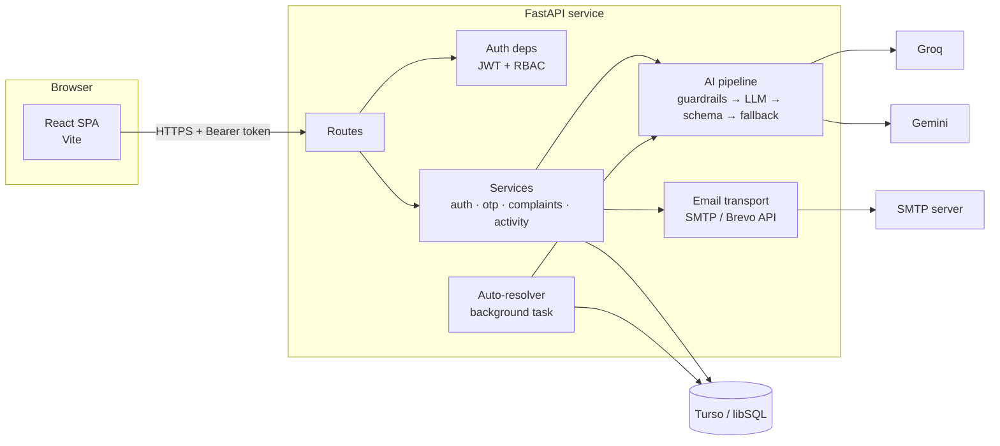

<p align="center">
  
</p>

<p align="center">
  Complaint management with AI triage and human-reviewed resolutions.<br>
  FastAPI · React · Turso (libSQL) · Groq / Gemini
</p>

---

## What it does

Customers register (verified email + Indian mobile number), file complaints and track them. Each complaint is triaged by an LLM: category, priority, sentiment, an acknowledgement and a draft resolution grounded in a small policy knowledge base. It is then routed to a support agent. Low-risk complaints with a high-confidence draft can be resolved automatically. Anything sensitive waits for a human to approve it.

| Area | Implemented |
|---|---|
| Accounts | Signup with mandatory email OTP, password login, passwordless OTP login, Google sign-in (token verified server-side, then email OTP), password reset by OTP, logout / logout-all, refresh-token rotation |
| Roles | `customer`, `agent`, `admin`. Enforced on every API route; role changes take effect immediately |
| Complaints | Ticket IDs, AI triage, department routing to the least-loaded agent, statuses (`open → in_progress → awaiting_approval → resolved → closed`), history timeline, internal notes, public replies, attachments (PNG/JPEG/PDF/TXT), ratings, "not resolved" reopening, in-app notifications, CSV export |
| AI | One structured LLM call (Groq, then Gemini) under a timeout, strict schema validation with one repair retry, deterministic offline fallback, prompt-injection screening, human-approval gate, multi-model validation of drafts, per-call execution log |
| Dashboards | Customer (overview, submit, my complaints, profile, feedback, notifications), agent (queue, ticket detail, AI validation, send resolution, resolution log), admin (complaints, users and roles, categories, AI monitoring, audit log, login history, system status) |

### What it does **not** do (yet)

Multi-tenant workspaces, Gmail/Outlook mailbox integration, an embeddable widget, SLA timers, subscriptions and payments are **not implemented**. See [Roadmap](#roadmap).

## Architecture



```
backend/app/
  core/        config (fail-fast), security (Argon2, JWT, HMAC), errors, logging, rate limit, middleware
  db/          Turso dialect (official libsql SDK), engine/session, models, versioned migrations
  api/         deps (auth/RBAC), complaint routes, public chatbot
  routes/      auth, agent workspace, admin, notifications, feedback
  services/    auth, OTP, complaints, notifications/audit, email, auto-resolver, multi-model validator
  agents/      llm client, guardrails, orchestrator, offline analyser, churn/urgency heuristics, chat
backend/scripts/  turso_snapshot.py (backup / migration rehearsal), evaluate_classifier.py
```

## Registration and OTP flow

1. `POST /auth/register` validates name, email (trimmed, lower-cased), mobile (`^[6-9]\d{9}$`, digits only) and password (8+ characters, a letter and a digit). It checks uniqueness against existing accounts.
2. The signup is stored in `pending_registrations`. **No account exists yet.** A 6-digit code (from `secrets`) is emailed; only its HMAC-SHA256 is stored.
3. `POST /auth/verify-registration` checks the code. Only then is the `customer` account created and signed in.

Rules: the code expires after 5 minutes and is single-use. A new code invalidates the previous one. Resends have a 60-second cooldown and are capped at 5 per email per hour. Each code allows 5 wrong attempts, and each email 10 failures per 15 minutes. If the email can't be delivered, the code is discarded and the API returns 503: nothing is activated, and codes never appear in responses or logs.

Accounts created before this version have `email_verified = false`. They confirm their address with an OTP on their next login (`EMAIL_NOT_VERIFIED` → `/auth/resend-otp` with `purpose=verify_email` → `/auth/verify-email`). Unverified accounts cannot call protected APIs.

## AI pipeline (as implemented)

| Step | How |
|---|---|
| Input screening | Control characters stripped, `<complaint>` delimiters neutralised, injection phrasing detected on the raw text |
| Retrieval | TF-IDF over `app/knowledge_base/policies.json` (8 policy documents) |
| Analysis | One LLM call: Groq first, Gemini second, `AI_TIMEOUT_SECONDS` budget, JSON mode |
| Validation | Pydantic schema (enums + length limits), leak checks for secrets / prompt text; one repair retry; otherwise offline analysis. Invalid output is never stored |
| Heuristics | Churn risk (small logistic regression), urgency (keywords + TextBlob polarity), recommended action from priority |
| Review gate | Human approval required for security, high-priority, angry, suspected-injection or offline-analysed complaints |
| Auto-resolution | After `AUTO_RESOLVE_DELAY_SECONDS`, the multi-model validator scores the draft. It is emailed only if not flagged **and** confidence ≥ `AUTO_RESOLVE_MIN_CONFIDENCE`; otherwise it waits for an agent |

**Measured accuracy** (`python scripts/evaluate_classifier.py [--llm]`, 29 labelled examples in `Training_data/`, run on 2026-11-13):

| Analyser | Category | Priority |
|---|---|---|
| LLM pipeline (configured providers) | 29/29 (100%) | 23/29 (79%) |
| Offline fallback (keywords + TF-IDF) | 20/29 (69%) | 11/29 (38%) |

These examples are few and were written by the project authors, so the numbers are a sanity check, not a benchmark. The weak fallback is why its results always go to a human.

## Setup

### 1. Turso

```bash
turso db create quickfix-prod            # and quickfix-staging for testing
turso db show quickfix-prod --url        # -> TURSO_DATABASE_URL
turso db tokens create quickfix-prod     # -> TURSO_AUTH_TOKEN
```

Turso is the only supported database. There is no PostgreSQL, MySQL or SQLite fallback. For offline development or tests you can opt in explicitly to a local libSQL file with `TURSO_DATABASE_URL=file:local-dev.db`. It uses the same driver and is refused in production.

### 2. Email (SMTP)

Set `SMTP_HOST`, `SMTP_PORT` (587 STARTTLS / 465 TLS), `SMTP_USERNAME`, `SMTP_PASSWORD`, `SMTP_FROM_EMAIL` and `SMTP_FROM_NAME`. Some hosts block outbound SMTP ports; there, use `EMAIL_TRANSPORT=brevo` with `BREVO_API_KEY`. For local development, `docker compose --profile mail up` starts Mailpit (UI on :8025; use `SMTP_HOST=mailpit SMTP_PORT=1025 SMTP_STARTTLS=false`).

### 3. Environment

Copy `backend/.env.example` → `backend/.env` and `frontend/.env.example` → `frontend/.env`. Every variable is documented there. In production the API **refuses to start** if any of these is missing: `TURSO_DATABASE_URL`, `TURSO_AUTH_TOKEN`, `JWT_SECRET_KEY` (32+ chars), SMTP settings or `FRONTEND_URL`.

### 4. Run locally

```bash
cd backend
python -m venv .venv && . .venv/bin/activate      # Windows: .venv\Scripts\activate
pip install -r requirements-dev.txt
python -m app.db.migrate                           # also runs automatically on startup
uvicorn app.main:app --reload                      # http://localhost:8000/docs

cd ../frontend
npm ci && npm run dev                              # http://localhost:5173
```

### 5. Create the first admin

Public signup only creates customers, and no role can be self-assigned. After the person has signed up and verified their email:

```bash
python -m app.cli promote --email you@example.com --role admin
python -m app.cli promote --email agent@example.com --role agent --department Billing
python -m app.cli list-staff
```

Admins can then manage roles from **Admin console → Users & roles**.

### Docker

```bash
docker compose up --build        # API :8000, web :5173 (Turso is external)
```

Both images include health checks. The API image runs as a non-root user, and `.env` files are excluded from images by `.dockerignore`.

## API

Interactive docs live at `/docs` in non-production environments. Summary:

| Area | Endpoints |
|---|---|
| Auth | `POST /auth/register`, `/auth/verify-registration`, `/auth/resend-otp`, `/auth/verify-email`, `/auth/login`, `/auth/request-otp`, `/auth/verify-otp`, `/auth/google`, `/auth/google-verify-otp`, `/auth/refresh`, `/auth/logout`, `/auth/logout-all`, `/auth/forgot-password`, `/auth/reset-password`, `/auth/change-password`; `GET/PATCH /auth/me` |
| Complaints | `POST /complaint`; `GET /complaints` (scoped, filters, pagination); `GET /complaints/{ticket}`, `/history`, `/attachments`; `POST /complaints/{ticket}/attachments`; `PATCH /complaint/{ticket}/status`; `PATCH /complaints/{ticket}/assign`; review, resolution-feedback and delete |
| Agent | `GET /agent/complaints/queue`, `/agent/complaints/{ticket}`; `POST /agent/complaints/{ticket}/claim`, `/notes`; `POST /agent/validate-solution`, `/agent/send-resolution`; `GET /agent/resolutions`, `/agent/audit-logs` |
| Admin | `GET /admin/overview`, `/users`, `/agents`, `/categories`, `/ai/logs`, `/ai/summary`, `/audit-logs`, `/login-history`, `/login-stats`, `/reports/complaints.csv`, `/system`; `PATCH /admin/users/{id}` |
| Other | `GET /notifications`, `POST /notifications/{id}/read`, `/read-all`; `POST /feedback`; `POST /agent/chat`; `GET|HEAD /health`, `/health/ready` |

Errors always have the shape `{"detail": "...", "code": "MACHINE_CODE", "request_id": "..."}`. Stack traces, SQL and request bodies are never returned.

## Testing

```bash
cd backend && python -m pytest                       # 170 tests (+3 live Turso tests, skipped by default)
TURSO_TEST_DATABASE_URL=libsql://staging... TURSO_TEST_AUTH_TOKEN=... python -m pytest tests/test_turso_live.py
cd frontend && npm test && npm run lint && npm run build   # 86 tests
```

Backend tests run against a real libSQL database file through the same dialect and migrations as production. They cover registration validation, every OTP rule, login lockout, refresh rotation and reuse detection, IDOR and role-escalation attempts, the complaint workflow, attachments, AI schema validation, provider failure and fallback, prompt injection, transactions and database-failure handling. The live tests only create, use and drop a uniquely named scratch table.

## Security notes

- Passwords are hashed with Argon2id. Legacy bcrypt hashes still verify and are upgraded on login.
- Access JWTs (15 min) carry `jti` and a token version. Refresh tokens are opaque, stored hashed, rotated on use, and revoke their whole family if reused. Logout revokes both.
- Every route resolves the user from the token and reads the role from the database. Customers see only their complaints, agents only their assigned ones, admins everything. Out-of-scope tickets return 404.
- Requests are rate-limited per IP; OTP and login limits are enforced from the database. Request bodies are capped (1 MB, uploads 2 MB). Uploads are checked against magic bytes.
- User text is escaped in all emails, CSV export guards against formula injection, and CORS is restricted to `FRONTEND_URL`.
- Admin access cannot come from signup or profile data. It is granted only through the CLI or by an existing admin.
- The access and refresh tokens are kept in `localStorage` (the API and web app are on different sites), so XSS protection matters. Keep the CSP in `vercel.json` / `nginx.conf` strict.

## Deployment and rollback

1. Back up production: `python scripts/turso_snapshot.py --out backup-YYYYMMDD.db` (read-only on the source).
2. Create a staging database from that copy (`turso db create quickfix-staging --from-file backup-YYYYMMDD.db`) and deploy this branch to a **separate** staging service, with its own secrets and `RUN_MIGRATIONS_ON_STARTUP=true`.
3. Verify on staging: signup with OTP email, login of an existing account (it will ask for email verification), complaint flow, admin console, `GET /health/ready`.
4. Deploy to production. Migration `0002` runs once on startup. It is forward-only: it renames `users.role` to `job_title` and drops the plaintext OTP columns.
5. **Rollback:** redeploy the previous release *and* restore the database from the snapshot (`turso db create quickfix-restore --from-file backup-YYYYMMDD.db`, then point `TURSO_DATABASE_URL` at it). The old code does not work with the migrated schema.
6. Promote the first admin with `python -m app.cli promote ...` (see above).

Uptime monitors can probe `HEAD /health` (liveness) or `GET /health/ready` (database reachable).

## Roadmap

Not implemented in this release. Each needs product decisions and/or external accounts:

- Multi-tenant organisations (workspaces, per-tenant roles, tenant isolation on every query)
- Email-to-ticket through Gmail / Microsoft Graph OAuth (needs Google Cloud and Azure app registrations)
- Embeddable complaint widget with domain restrictions
- SLA policies with persistent background jobs (the current auto-resolver schedules in memory and re-queues on startup)
- Subscriptions and payments (Razorpay test mode first)

## License

See [LICENSE](LICENSE).
